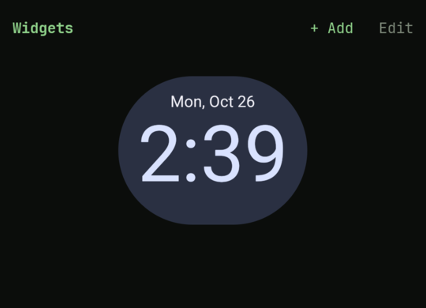

Kolahal can host the same home-screen widgets as any other launcher: clocks, weather, calendar,
music, notes. They live on a **widgets page** beside the terminal, so the terminal keeps all its
room.

## The widgets page

Swipe sideways on home (from the header, empty space or the prompt; a swipe that starts on a log
line copies or deletes that line instead) to reach the widgets page. **+ Add** and **Edit** are at
the top. Back or Home returns to the terminal. `widgets.page` picks the side (`left`, the default,
`right`) or turns the page `off`.



The page can show the phone's wallpaper (the one you set in Android) behind the widgets:
**Settings → Home screen → Wallpaper showing** (`widgets.wallpaper`) is how much of it shows, from
0 (none, the default) to 100 (all of it, with none of the theme's colour over it). The log has a
setting of its own for the same (`log.wallpaper`, under **Settings → Log**), so each page can show
more or less of it.

## Add a widget

Tap **+ add** on the widgets page, open **Settings → Widgets** (or `widgets`) and tap **Add
widget**, or go straight to the picker from the prompt with `widget add`.

The picker lists every installed widget, grouped by app, with its preview and default size
(`4×2` and so on). Tap one to add it:

1. The first time, Android asks whether Kolahal may create widgets. Allow it (tick "always" to skip
   the question next time).
2. If the widget has a setup screen (pick a city, a calendar, a note), it opens next. Backing out
   of it cancels the widget.

## Arrange and resize

Each widget has a width and a height. The page is twelve columns wide, so a widget can take a
sixth, a quarter, a third, half, two thirds or more of it, a twelfth at a time. Narrower widgets sit side by side in
page order, and the next one starts a new row when it doesn't fit beside them.

In **Settings → Widgets**, long-press a widget, or tap the edit button in the top bar and then a
widget, for its toolbar at the bottom:

| Button | Does |
| --- | --- |
| Width − / + | narrower or wider, a twelfth of the page at a time |
| Height − / + | shorter or taller, 8dp at a time (never below the size the widget needs) |
| Square | as tall as it is wide, or as close as the widget allows |
| ← / → | move it earlier or later on the page |
| delete | remove it (asks first) |

Hold − or + to keep going. The page in Settings shows the widgets as they are on the widgets page. Widgets are told their
real width and height, so they lay out for the space they get.

## Uninstalled apps and updates

When an app is updated, its widgets keep working. When it's uninstalled, its widgets are removed
from the page automatically.

## Backups

A [backup](/guides/backup/) records which widgets you placed, their size and order. Widgets
themselves can't be moved between installs, so after an import they show under **Restored from
backup** in Settings → Widgets; tap **Add again** on each to bind it (and run its setup if it has
one). It keeps its size and place. The same happens when Android restores Kolahal on a new phone
from its own backup.

## From the terminal

```sh
widgets        # open Settings → Widgets
widgets ls     # list placed widgets (tap a line to open them)
widget add     # open the picker
```

See also the [command reference](/reference/commands/#widgets) and
[configuration keys](/reference/config/#widgets).

## Work profile

Work-profile widgets work like any other, and carry a **work** badge in the picker. While the work
profile is paused (or the private space is locked) they show a dim **paused** placeholder instead,
and come back when you turn work apps on.
